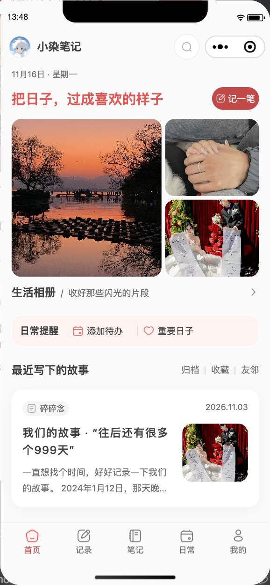
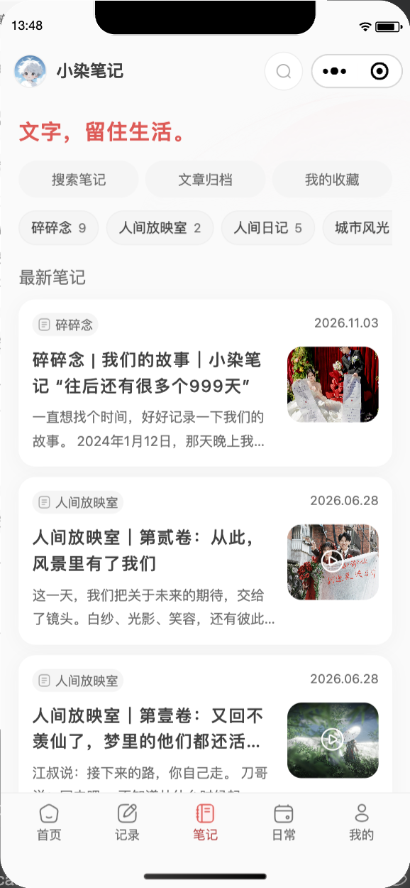
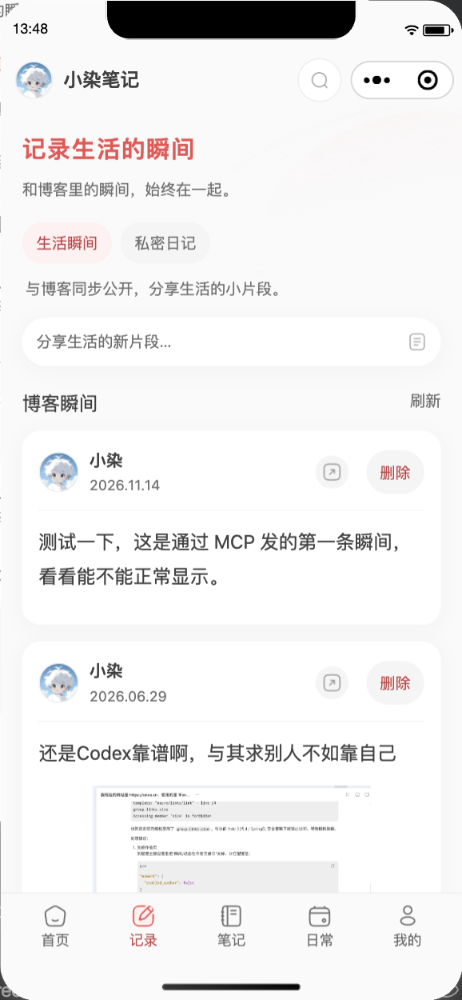
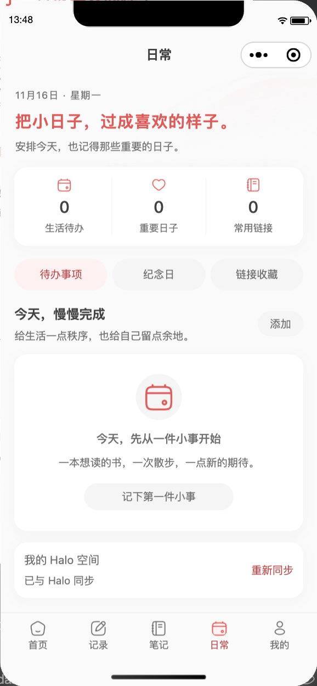
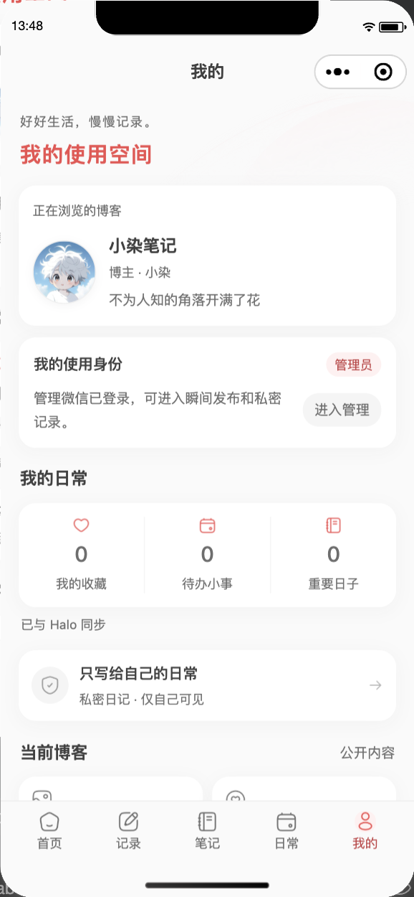
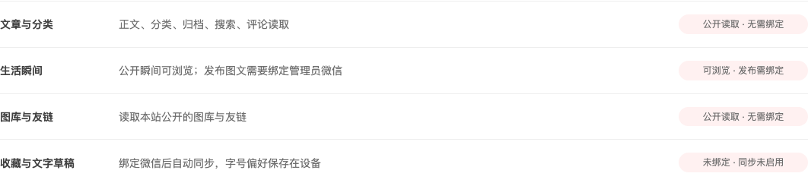
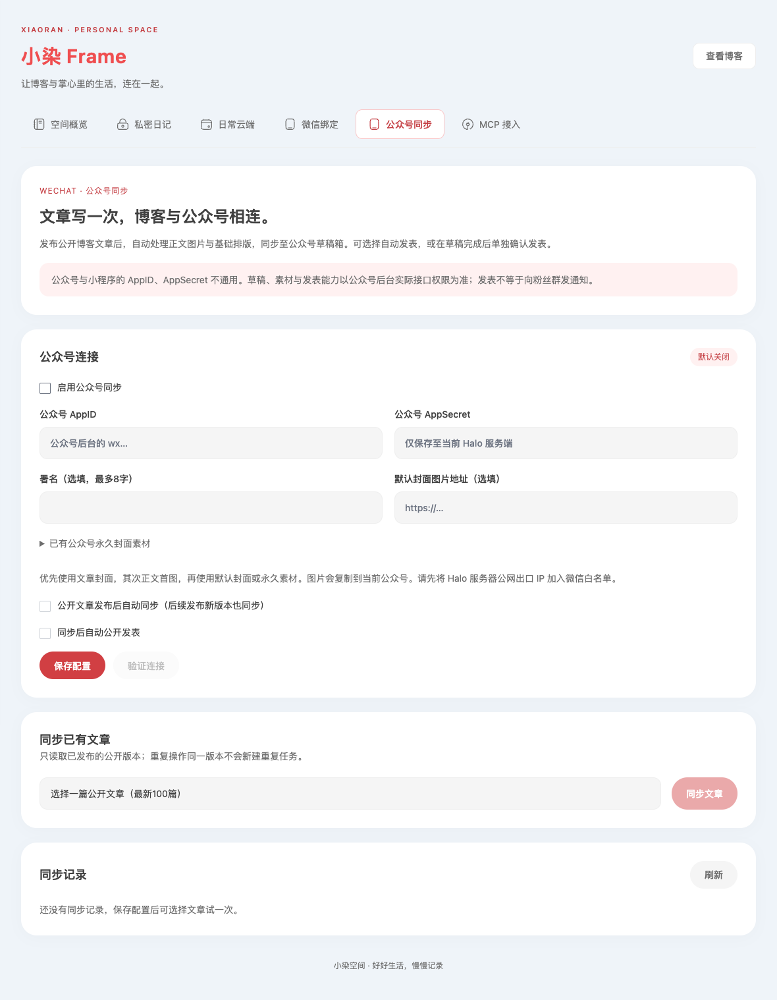

# 小染 Frame

将 Halo 博客与生活记录、微信小程序及自己的 MCP Agent 连接起来。

## 界面预览

以下小程序截图展示作者已配置的体验环境，安装插件不会自动获得共享小程序入口。

| 首页 | 笔记 | 记录 |
| --- | --- | --- |
|  |  |  |

| 日常 | 我的 |
| --- | --- |
|  |  |

### Halo 后台

公众号截图展示未配置状态；真实使用需提供自己的公众号凭据和相应接口权限。

## 当前版本与使用范围

- 插件版本：0.5.9；Halo：2.27.2 及以上；Java：21。
- 插件可在自己的 Halo 后台管理私密日记、待办、纪念日和常用链接，并按需向自己的 Agent 开放 MCP 工具。
- **配套微信小程序当前处于开发体验阶段，采用一个微信管理身份对应一个配置好的 Halo 的流程，不开放多博客切换。安装插件不等于自动接入共享小程序，也不提供任意 Halo 一键接入正式版小程序的承诺。**
- 如需将小程序管理功能用于自己的 Halo，需要配套部署/配置与该站点对应的小程序前端及微信服务端参数，并遵守微信小程序的合法域名等要求。小程序截图展示作者已配置环境，不表示安装 JAR 后即可获得相同微信客户端入口。
- 本项目与 Halo 官方、星度主题不存在官方隶属或认证关系；插件不依赖星度主题，也不分发其主题文件或字体。

## 功能

### Halo 管理后台

- 私密日记：新增和查看仅管理端及已绑定微信可读的记录。
- 日常云端：待办事项、纪念日、常用链接直接保存在本站 Halo。
- 微信绑定：一次绑定；小程序管理会话失效后静默恢复身份；退出与解绑为两个独立操作。
- MCP：生成自己的 Agent 连接说明，管理与撤销 Agent 连接。

### 配套小程序（需完成前述接入配置）

- 阅读本站公开文章，浏览分类、归档、相册、瞬间与友链。
- 绑定微信后发布图文瞬间、删除本人发布的瞬间、保存和查看私密日记。
- 收藏、待办、纪念日、链接、文字草稿与已上传图片引用自动同步至对应 Halo。
- 离线修改先暂存本机，恢复联网后重试；两端同一条内容冲突时保留双方并由用户选择。
- “退出登录”保留绑定，暂停当前设备的自动登录；“解除微信绑定”撤销所有小程序管理会话，保留业务数据。

### 公众号同步（0.5.0）

- 在“小染空间 → 公众号同步”配置公众号专用 AppID / AppSecret、署名和默认封面，与小程序凭据分开。
- 默认关闭。可以启用公开文章发布或发布新版本后的自动同步，也可以从最新100篇公开文章中手动选择。
- 正文图片复制到微信，封面上传为永久素材，进行基础排版并带上阅读原文链接。
- 默认只创建草稿。可在草稿就绪后确认发表，或明确启用自动公开发表。发表不等于向粉丝群发通知。
- 同一公众号、同一文章发布快照只建一个任务。失败可重试；超时结果不明时先核对公众号后台，避免重复。
- 只有微信返回最终成功状态才显示已发表；支持查询结果和查看公众号文章链接。
- 私密、未发布及定时未到期文章不发送，任务处理时再次核验文章可见性和发布快照。不会自动回撤公众号既有内容。
- 需要公众号具备相应接口权限，并配置服务器公网出口IP白名单。账号能力以微信后台为准。已验证真实图文同步至草稿箱，尚未完成真实公开发表验收。

### MCP Agent

- 默认提供公开内容搜索与读取工具。
- 每个 Agent 的写权限分别授权；写入需要配置本站管理用户与公开图片存储策略。
- 授权后可上传公开图片、发布公开瞬间；Agent 必须先向用户展示内容并取得明确发布确认。
- 插件不提供模型服务，不要求配置模型供应商密钥；用户自行选择和运行自己的 Agent。
- 当前不通过 MCP 开放私密日记读取或内容删除工具。实际工具列表以该连接返回的 tools/list 为准。

## 安装与配置

1. 在 Halo 后台“插件”上传本插件 JAR 并启用，进入“小染空间”。
2. 无需配置微信即可使用 Halo 后台日记及日常管理。
3. 如需 MCP，在“MCP 接入”启用服务，为自己的 Agent 创建连接；按页面指引复制连接说明。令牌不要公开分享。
4. 如需微信管理功能，在 Halo 运行环境中配置下列参数，并准备指向本站的配套小程序：

| 环境变量 | 用途 |
| --- | --- |
| `XIAORAN_WECHAT_APP_ID` | 对应微信小程序 AppID |
| `XIAORAN_WECHAT_APP_SECRET` | 微信服务端校验；只保存在服务器 |
| `XIAORAN_HALO_OWNER` | 用于瞬间及附件管理的本站 Halo 用户名 |
| `XIAORAN_PUBLIC_IMAGE_POLICY` | 本站公开图片的附件存储策略名称 |

5. 启用所需内容插件的公开 API。瞬间功能依赖 Halo 瞬间插件；图库、友链展示分别依赖对应插件和公开接口。插件不会自动安装它们，也不会替用户购买云存储。
6. 在“微信绑定”生成五分钟有效的一次性绑定码，在对应小程序首次绑定。已绑定后不再显示生成绑定码按钮。
7. 公开图片会产生可访问的公开地址。小程序和 Agent 发布前均需确认公开；移除草稿中的图片引用不会删除 Halo 附件。

## 数据与隐私

- 公众号同步由本站服务器将选定的公开文章、公开图片、署名和原文链接直接发送至微信官方API。公众号AppSecret只存本站Halo Secret，不回显、不下发至小程序。这部分内容不经过作者中转服务。
- 日记、日常、收藏、草稿、绑定关系保存在安装此插件的 Halo 数据库；图片保存在该站点自行配置的 Halo 附件存储中。
- 微信身份校验将临时 code、AppID 和服务端 AppSecret 发送至微信官方 `api.weixin.qq.com`，获取绑定识别所需的 OpenID。AppSecret 不下发至小程序。
- Agent 连接凭据在 Halo 中仅保存用于校验的摘要。Agent 会收到其权限允许的内容，Agent 服务自身的数据处理由用户选择的服务负责。
- 共享公开内容网关属于可选接入设施；当前小程序不开放自助多博客连接。后台日记、日常管理和站点直连 MCP 不要求将私密业务数据上传到作者站点。
- 开发体验小程序的公开媒体可能按微信加载要求经过作者维护的媒体中转；这部分不应与站点直连 MCP 或 Halo 后台数据存储混为一谈。
- 没有内置广告、付费解锁或模型计费；Halo 主机、域名、微信平台及自选对象存储/Agent 服务的成本由使用者自行承担。
- 正常升级保留绑定与业务数据。已同步内容可以从 Halo 恢复；本机尚未同步且已被清除的数据无法恢复，服务器仍需配置备份。

## 升级、停用与卸载

升级前请备份 Halo 数据库及附件。通过插件管理升级新 JAR，保留原扩展类型与数据；旧管理会话失效后，由配套小程序重新校验微信身份。

停用后本插件的后台入口和自定义 API 不可用。退出登录、解除绑定、删除插件和删除数据库数据是不同操作；退出/解绑不会删除日记或日常数据。卸载前自行导出需要保留的数据，并核对 Halo 对扩展数据的处理方式；本项目不承诺卸载或删除 Halo 数据库后仍能恢复内容。

## 常见问题

- **安装后小程序无法连接？** 当前没有任意博客自助接入共享小程序的功能，先核对配套前端、站点域名及微信服务端配置。不要把插件安装成功理解为微信端已完成配置。
- **只能浏览、不能发布？** 检查微信绑定、瞬间插件、`XIAORAN_HALO_OWNER` 与图片存储策略；公开浏览不会自动授予管理权限。
- **同步显示待处理？** 离线时保留本机修改，联网后重试；同条内容冲突时在日常页处理冲突，不要先清除缓存。
- **Agent 只能读？** 默认权限如此。需在本站后台单独给该 Agent 开放写入并配置公开图片存储。

## 支持与源码

作者：小染。源码仓库：[halo-plugin-xiaoran-frame](https://github.com/xiaoRran/halo-plugin-xiaoran-frame)。问题反馈：[GitHub Issues](https://github.com/xiaoRran/halo-plugin-xiaoran-frame/issues)。作者主页：[小染笔记](https://onoe.cn)。反馈时请附插件/Halo 版本、复现步骤和已去除凭据的错误信息，不要发送 AppSecret、会话或 Agent 令牌。

GPL-3.0。完整插件源码、构建配置和许可证在本仓库公开，发布资料同时提供对应源码压缩包。

本项目初始工程来自 [Halo plugin-starter](https://github.com/halo-dev/plugin-starter)，在其基础上实现生活记录、微信绑定、自动同步与 MCP；并非接续维护一个已停止维护的同功能插件。第三方依赖继续遵守各自许可证。

本版本使用 AI 辅助开发与图标生成，维护者负责功能验证、发布与后续维护。图标为独立生成的 Frame 记忆相框标识，不使用个人头像或 Halo 官方 Logo。

## 构建

需 JDK 21、Node.js 20 或以上。进入 `ui` 执行 `npm ci`，回到插件目录执行 `bash ./gradlew clean test build`。如 Gradle 环境无法找到 npm，可将 `XIAORAN_NPM` 指向本机 npm 的绝对路径。
